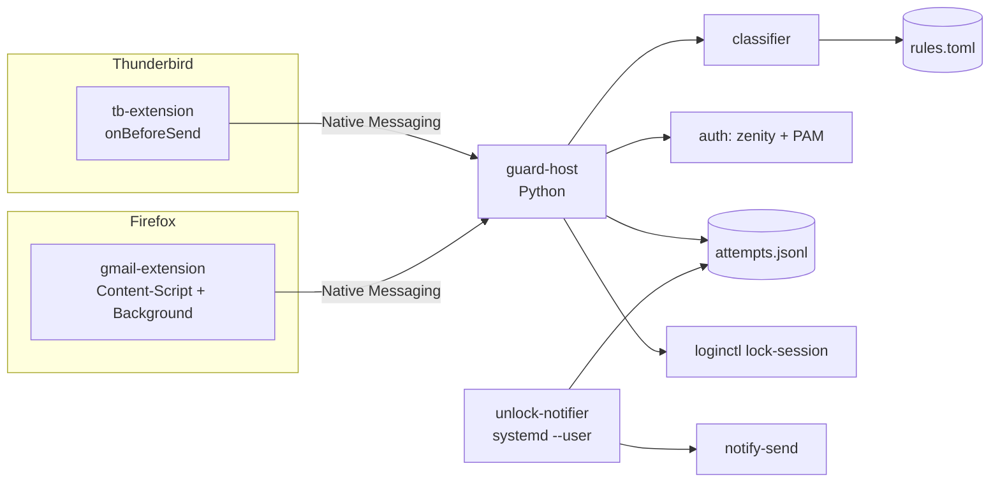
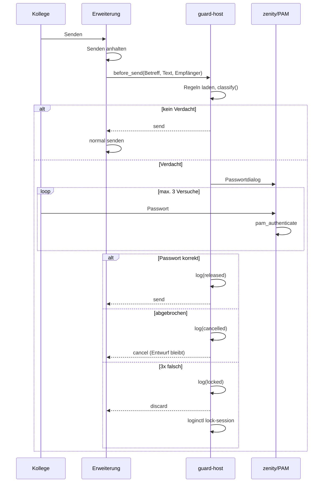
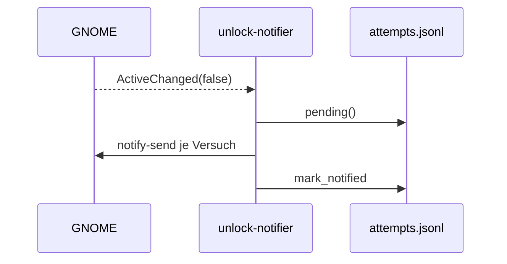

# Design: Kuchenmail-Guard

> Status: Entwurf · Basis: requirements.md (freigegeben 2026-10-22)

## Überblick

Zwei kleine Erweiterungen greifen dort ein, wo die Mail geschrieben wird: eine Thunderbird-Erweiterung und eine Firefox-Erweiterung für Gmail. Beide fragen beim Senden (und während des Schreibens) einen lokalen Python-Prozess, den **Guard-Host**, ob es sich um eine Kuchenmail handelt. Der Host bewertet den Text nach lokalen Regeln, fragt bei Verdacht dein Linux-Passwort ab, schreibt das Log und sperrt notfalls den Bildschirm. Ein kleiner Hintergrunddienst meldet dir Versuche, sobald du entsperrst. Nichts davon öffnet eine Netzwerkverbindung.

## Architekturentscheidungen

| Entscheidung | Gewählt | Alternativen | Begründung |
|---|---|---|---|
| Eingriffspunkt | Erweiterungen in Thunderbird und Firefox | (a) systemweites Mitlesen der Tastatur über evdev, (b) lokaler SMTP-Proxy, (c) Gesendet-Ordner überwachen | (a) braucht Root bzw. Gruppe `input`, ist faktisch ein Keylogger und kann das Senden nicht stoppen. (b) greift bei Gmail im Browser gar nicht und bei Thunderbird nur mit TLS-Aufbruch. (c) ist zu spät. Nur Erweiterungen sehen Text **und** können das Senden abbrechen. |
| Thunderbird-Hook | `compose.onBeforeSend` (MailExtension-API), Rückgabe `{cancel: true}` | Eigenes Overlay/Legacy-Add-on | Offizielle API, liefert `to/cc/bcc`, `subject`, `body`, `plainTextBody` und kann den Versand abbrechen. Legacy-Add-ons laufen nicht mehr. |
| Gmail-Hook | Content-Script auf `mail.google.com`, das Klick auf „Senden“ und `Strg+Enter` in der Capture-Phase abfängt | Gmail-API, Userscript (Tampermonkey) | Gmail-API bräuchte OAuth und Netzwerk. Ein Userscript-Manager ist zusätzliche Fremdsoftware ohne Native Messaging. |
| Ort der Erkennung | Zentral im Python-Host | Regeln doppelt in JS in beiden Erweiterungen | Eine Implementierung, eine Regeldatei, ein Test-Korpus. Native Messaging ist lokal (stdin/stdout). |
| Sprache Host | Python 3, nur Standardbibliothek (`tomllib`, `ctypes`, `json`) | Rust, Go | Auf Fedora vorinstalliert, nichts zu kompilieren, kein `pip`. |
| Passwortprüfung | PAM über `ctypes` (`libpam.so.0`, Dienst `login`) | polkit (`pkcheck`), eigene PIN | polkit bräuchte eine Policy-Datei unter `/usr/share/polkit-1/actions` und damit Root (widerspricht N6). PAM prüft das echte Systempasswort (N7) und funktioniert für den eigenen Nutzer ohne Root (`unix_chkpwd`). |
| Passwort-Dialog | `zenity --password` (Teil von Fedora Workstation) | Eigenes GTK-Fenster, Dialog in der Erweiterung | Systemdialog, außerhalb der Webseite, nicht per DOM manipulierbar. Das Passwort fließt nie durch die Erweiterung. |
| Regel-Format | TOML (`~/.config/kuchenmail-guard/rules.toml`) | JSON, YAML | Menschenlesbar mit Kommentaren, `tomllib` ist in Python ≥ 3.11 eingebaut. |
| Erkennungsverfahren | Gewichtete Regeln (Score) | ML-Klassifikator | Nachvollziehbar, lokal, ohne Trainingsdaten; Gewichte über das Test-Korpus kalibrierbar. |
| Bildschirm sperren | `loginctl lock-session` | `gnome-screensaver-command`, D-Bus `org.gnome.ScreenSaver.Lock` | Ohne Root, unabhängig von der Desktop-Version. D-Bus als Fallback. |
| Hinweis nach Entsperren | systemd-User-Dienst, der D-Bus-Signal `org.gnome.ScreenSaver.ActiveChanged(false)` abhört, dann `notify-send` | Hinweis direkt beim Abfangen | Beim Abfangen sitzt der Kollege davor, nicht du (R3.2). |
| Firefox-Signatur | Unsigniert nicht dauerhaft installierbar in Release-Firefox; daher **unlisted** über AMO signieren (`web-ext sign`) | Firefox Developer Edition/ESR mit `xpinstall.signatures.required=false`, Laden über `about:debugging` | Fedora liefert Release-Firefox. Beim Signieren wird nur der Code der Erweiterung hochgeladen, keine Nutzerdaten (N1 bleibt erfüllt). `about:debugging` hält nur bis zum Neustart. → **Entscheidung durch Linus**, siehe Risiken. |

## Architektur

## Komponenten

### classifier (`guard/classifier.py`)

- **Verantwortung:** Bewertet eine Mail und liefert Score, Verdacht ja/nein und die Treffer.
- **Schnittstelle:** `classify(mail: MailDraft, rules: Rules) -> Verdict`; `strip_quotes(text: str, html: str | None) -> str`
- **Vorgehen:**
  1. Zitate entfernen: Zeilen mit `>`; HTML-Blöcke `blockquote[type=cite]`, `.moz-cite-prefix`, `.gmail_quote`; alles nach „Am … schrieb …:“ / „On … wrote:“ / „-------- Weitergeleitete Nachricht --------“ (R1.5).
  2. Text normalisieren: Kleinschreibung, Umlaute vereinheitlichen, Satzweise zerlegen.
  3. Score pro Satz: `food` (Kuchen, Torte, Muffins, Brownies, Croissants, Brötchen, Pizza, Eis, Donuts, cake …) + `offer` (bringe … mit, gebe … aus, spendiere, lade … ein, „geht auf mich“, I'll bring, treat, my shout …) + `timing` (morgen, heute, Freitag, tomorrow …). Ein Satz zählt nur, wenn `food` **und** `offer` treffen; Betreff zählt wie ein Satz.
  4. Bonus `recipients > 3` oder Empfänger passt auf `distribution_patterns` (z. B. `team@`, `alle@`) (R1.3).
  5. `suspicious = score >= threshold`.
- **Abhängigkeiten:** keine
- **Erfüllt:** R1.1, R1.3, R1.4, R1.5, N2, N3, N4

### rules (`guard/rules.py`, `guard/default_rules.toml`)

- **Verantwortung:** Lädt `~/.config/kuchenmail-guard/rules.toml` bei jeder Anfrage neu, wenn sich `mtime` geändert hat; sonst Cache. Fällt bei fehlender oder ungültiger Datei auf die eingebauten Standardregeln zurück und loggt eine Warnung.
- **Schnittstelle:** `load_rules() -> Rules`
- **Erfüllt:** R4.1, R4.2, R4.3

### guard-host (`guard/host.py`, Einstieg `kuchenmail-guard-host`)

- **Verantwortung:** Native-Messaging-Host für beide Erweiterungen. Läuft, solange die Erweiterung den Port offen hält (`runtime.connectNative`), also ohne Prozessstart pro Anfrage.
- **Schnittstelle:** siehe „Nachrichten“. Protokoll: 4 Byte Länge (native byte order) + UTF-8-JSON.
- **Abhängigkeiten:** classifier, rules, auth, attempt_log, lock
- **Erfüllt:** R1.2, R2.1–R2.5, R4.5

### auth (`guard/auth.py`)

- **Verantwortung:** Passwort abfragen und gegen PAM prüfen, max. 3 Versuche.
- **Schnittstelle:** `confirm_send(subject: str) -> Outcome` mit `Outcome ∈ {RELEASED, CANCELLED, FAILED}`
- **Ablauf:** `zenity --password --title "Kuchenmail-Verdacht"` mit Text „Betreff: … Zum Senden Passwort eingeben.“ Abbrechen → `CANCELLED`. Eingabe → `pam_authenticate` über `ctypes` (Dienst `login`, Konversationsfunktion liefert das Passwort). Nach 3 Fehlschlägen → `FAILED`.
- **Erfüllt:** R2.2, R2.3, R2.4, N7

### lock (`guard/lock.py`)

- **Verantwortung:** Bildschirm sperren.
- **Schnittstelle:** `lock_screen() -> None` (`loginctl lock-session`, Fallback `gdbus call … org.gnome.ScreenSaver.Lock`)
- **Erfüllt:** R2.4, R4.5

### attempt_log (`guard/attempt_log.py`)

- **Verantwortung:** Versuche protokollieren und „noch nicht gemeldet“ markieren.
- **Schnittstelle:** `append(attempt: Attempt)`, `pending() -> list[Attempt]`, `mark_notified(ids)`
- **Ablage:** `~/.local/state/kuchenmail-guard/attempts.jsonl`, Rechte 0600, Ordner 0700. Warnungen in `guard.log` daneben.
- **Erfüllt:** R3.1, R3.3, N1 (nur Betreff und Empfänger, kein Mailtext)

### unlock-notifier (`guard/notifier.py`, `kuchenmail-guard-notifier.service`)

- **Verantwortung:** Hört per `gdbus monitor --session --dest org.gnome.ScreenSaver` auf `ActiveChanged false`. Beim Start (= nach Anmeldung) und bei jedem Entsperren: `pending()` lesen, je Versuch `notify-send "Kuchenmail abgefangen" "Heute 14:32: 'Kuchen morgen!' an team@…"`, dann `mark_notified`.
- **Erfüllt:** R3.2, R4.4, N5

### tb-extension (`extensions/thunderbird/`)

- **Verantwortung:** `compose.onBeforeSend`-Listener: Details an den Host senden, auf Antwort warten, `{cancel: true}` zurückgeben, wenn nicht `send`. Bei `discard`: Compose-Fenster schließen (`windows.remove`). Für R4.5 alle 2 s `compose.getComposeDetails` für offene Compose-Tabs (nur wenn Option aktiv) und `check` senden.
- **Berechtigungen:** `compose`, `nativeMessaging`
- **Erfüllt:** R1.2, R2.1, R2.3, R2.5, R4.5

### gmail-extension (`extensions/gmail/`)

- **Verantwortung:**
  - Content-Script auf `https://mail.google.com/*`: `click`-Listener (Capture) auf Senden-Buttons und `keydown` für `Strg/⌘+Enter` im Compose-Dialog. Liest Betreff (`input[name=subjectbox]`), Text (contenteditable des Dialogs) und Empfänger (Chips mit `email`-Attribut). Hält das Event an (`preventDefault`, `stopImmediatePropagation`), fragt über das Background-Script den Host, und löst bei `send` den Klick erneut aus (mit internem Freigabe-Flag, damit er nicht erneut abgefangen wird).
  - Background-Script: hält den Native-Port, leitet Nachrichten weiter.
  - Für R4.5: `input`-Events im Compose-Dialog mit 1 s Debounce → `check`.
- **Selektoren:** zentral in `selectors.js`, damit Gmail-Änderungen an einer Stelle angepasst werden.
- **Berechtigungen:** `nativeMessaging`, Host-Berechtigung `https://mail.google.com/*`
- **Erfüllt:** R1.2, R2.1, R2.3, R2.5, R4.5

### installer (`install.sh`, `uninstall.sh`)

- **Verantwortung:** Ohne Root: Python-Paket nach `~/.local/share/kuchenmail-guard/`, Starter nach `~/.local/bin/`, Native-Messaging-Manifeste nach `~/.mozilla/native-messaging-hosts/` und `~/.thunderbird/native-messaging-hosts/` (**Annahme:** Thunderbird-Pfad, im Spike T2 prüfen), Standard-`rules.toml` (nur wenn noch keine existiert), systemd-User-Unit aktivieren. Erweiterungen (`.xpi`) werden gebaut und der Installationsdialog von Thunderbird/Firefox geöffnet.
- **Erfüllt:** R4.4, N6

## Datenmodell

| Entität | Felder | Hinweis |
|---|---|---|
| `MailDraft` | `client` (`thunderbird`/`gmail`), `subject`, `plain_text`, `html` (optional), `recipients: list[str]` | Nur im Speicher |
| `Verdict` | `suspicious: bool`, `score: float`, `hits: list[str]` | `hits` z. B. `["food:kuchen", "offer:bringe mit", "recipients>3"]` |
| `Attempt` | `id` (UUID), `ts` (ISO 8601), `client`, `subject`, `recipients`, `score`, `outcome` (`cancelled`/`released`/`locked`/`locked_on_detect`), `notified: bool` | Eine Zeile JSON in `attempts.jsonl` |
| `Rules` | `threshold`, `weights.{food,offer,timing,recipients}`, `food[]`, `offer[]`, `timing[]`, `distribution_patterns[]`, `recipient_limit` (3), `lock_on_detect` (false) | `rules.toml` |

## Schnittstellen / Nachrichten (Native Messaging)

| Anfrage (`type`) | Request | Antwort | Wann |
|---|---|---|---|
| `before_send` | `{type, client, subject, plain_text, html?, recipients}` | `{action: "send"}` · `{action: "cancel"}` · `{action: "discard"}` | Beim Senden (R2) |
| `check` | wie oben | `{suspicious, score}`; Host sperrt selbst, wenn `lock_on_detect` | Während des Schreibens, nur wenn `lock_on_detect` (R4.5) |
| `ping` | `{type}` | `{ok: true, version}` | Beim Start der Erweiterung |
| (Fehler) | – | `{error: "<code>"}` | Ungültige Nachricht |

Abbildung im Host: nicht verdächtig → `send`; `RELEASED` → `send`; `CANCELLED` → `cancel`; `FAILED` → `discard` + `lock_screen()`.

## Abläufe

### Senden in Thunderbird bzw. Gmail

### Benachrichtigung nach Entsperren

## Fehlerbehandlung

| Fehlerfall | Verhalten | Anforderung |
|---|---|---|
| `rules.toml` fehlt oder ist ungültig | Standardregeln, Warnung in `guard.log` | R4.3 |
| Host nicht installiert/abgestürzt (Port-Fehler) | **Fail-closed:** Erweiterung bricht das Senden ab und zeigt den Hinweis „Kuchenmail-Guard nicht erreichbar“ (Entscheidung offen, siehe Risiko 3) | R2.1 |
| Host antwortet nicht innerhalb 120 s (Dialog offen gelassen) | Wie `cancel` | R2.3 |
| `zenity` fehlt | Host loggt Fehler, Antwort `cancel` | R2.3 |
| `loginctl` schlägt fehl | Fallback D-Bus `org.gnome.ScreenSaver.Lock`, Fehler loggen | R2.4 |
| Gmail-Selektor findet Text/Betreff nicht | Fail-closed wie oben, Warnung in Konsole und Log | R1.2 |
| Logdatei nicht schreibbar | Weiter abfangen, Warnung über `notify-send` | R3.1 |

## Sicherheit

- Passwort nur zwischen `zenity` (stdout-Pipe) und PAM im Host-Prozess; nie in Erweiterung, Log oder Datei. Speicher wird nach Prüfung überschrieben (best effort, Python-Grenzen).
- Native-Messaging-Manifeste erlauben nur die IDs der beiden eigenen Erweiterungen (`allowed_extensions`).
- Host öffnet keine Sockets; Test prüft, dass `socket` nicht importiert wird (N1).
- Log enthält keinen Mailtext (N1), Rechte 0600 (R3.3).
- **Bekannte Grenze:** Wer am entsperrten Rechner sitzt, kann die Erweiterung deaktivieren oder den Host löschen. Das hält Gelegenheits-Streiche auf, keine gezielten Angriffe. Ein Neustart des Hosts bzw. eine fehlende Erweiterung wird beim nächsten Entsperren gemeldet (Notifier prüft `ping`-Zeitstempel). **Annahme:** reicht für den Zweck.

## Teststrategie

| Ebene | Was | Werkzeug |
|---|---|---|
| Unit | `classifier` gegen Korpus `tests/corpus/cake/*.eml` (≥ 30) und `tests/corpus/normal/*.eml` (≥ 50, inkl. „Kuchen ist in der Küche“, Kantinenplan, Rezept-Weiterleitungen); misst N2/N3 | `pytest` (oder `unittest`, falls kein pytest) |
| Unit | `strip_quotes` mit Thunderbird- und Gmail-HTML-Zitaten | pytest |
| Unit | `rules` Neuladen bei `mtime`, Fallback bei kaputter Datei | pytest, `tmp_path` |
| Unit | `host` Protokoll (Längenpräfix, Fehlerantworten), `auth` mit gemocktem zenity/PAM | pytest, `monkeypatch` |
| Unit | Performance: 10 kB Mail < 200 ms (N4) | pytest-Zeitmessung |
| Integration | Host als Subprozess, echte Native-Messaging-Frames über stdin/stdout | pytest |
| E2E (manuell) | Checkliste `docs/e2e-checklist.md`: Thunderbird und Gmail jeweils Kuchenmail senden → Dialog → Abbruch/Freigabe/3x falsch; normale Mail; Entsperren → Benachrichtigung; `ss -tunp` zeigt keinen Socket des Hosts | Hand + Fedora-VM |
| Statisch | Erweiterungen | `web-ext lint` |

## Abdeckung

| Anforderung | Komponente(n) |
|---|---|
| R1.1 | classifier, rules |
| R1.2 | tb-extension, gmail-extension, guard-host |
| R1.3 | classifier |
| R1.4 | classifier, default_rules.toml |
| R1.5 | classifier (`strip_quotes`) |
| R2.1 | tb-extension, gmail-extension, guard-host |
| R2.2 | auth |
| R2.3 | auth, Erweiterungen |
| R2.4 | auth, lock, Erweiterungen (`discard`) |
| R2.5 | guard-host, Erweiterungen |
| R3.1 | attempt_log |
| R3.2 | unlock-notifier |
| R3.3 | attempt_log |
| R4.1 | rules |
| R4.2 | rules |
| R4.3 | rules |
| R4.4 | unlock-notifier (systemd), installer |
| R4.5 | Erweiterungen (`check`), guard-host, lock |
| N1 | gesamter Host, attempt_log, Sicherheitstest |
| N2, N3 | classifier + Korpus |
| N4 | classifier, guard-host (persistenter Port) |
| N5 | unlock-notifier |
| N6 | installer |
| N7 | auth |

Lücken: keine Anforderung ohne Komponente. R1.2 und N3 für Gmail hängen an den DOM-Selektoren (Risiko 1).

## Risiken & offene Punkte

1. **Gmail-DOM ändert sich** (Klassen sind generiert) → Selektoren nur über stabile Attribute (`name=subjectbox`, `role`, `aria-label`, `data-tooltip`), zentral in `selectors.js`, fail-closed. Frühzeitig im Spike T2 prüfen.
2. **Firefox-Signatur (Entscheidung Linus):** (a) einmalig als *unlisted* bei addons.mozilla.org signieren lassen (Mozilla-Konto nötig, nur Code wird hochgeladen; empfohlen), (b) Firefox Developer Edition nutzen, (c) bei jedem Firefox-Start über `about:debugging` laden.
3. **Fail-closed vs. fail-open**, wenn der Host nicht läuft: Empfehlung fail-closed (Senden blockiert, Hinweis). Kehrseite: Ist das Tool kaputt, kannst du aus Thunderbird/Gmail erst nach Deaktivieren der Erweiterung senden.
4. **Thunderbird-Native-Messaging-Pfad** auf Linux nicht offiziell dokumentiert gefunden → Installer legt das Manifest in beide Orte; Spike T2 bestätigt.
5. **`onBeforeSend` und lange Dialoge:** Die API nennt Einschränkungen für asynchrone Listener. Spike T2 prüft, dass ein offener Passwortdialog (bis 120 s) das Senden zuverlässig anhält.
6. **Annahme:** Gmail läuft in Firefox (offene Frage in requirements.md).

Quellen: [Thunderbird compose API](https://webextension-api.thunderbird.net/en/115/compose.html), [MDN Native manifests](https://developer.mozilla.org/en-US/Add-ons/WebExtensions/Native_manifests), [Firefox Signing](https://extensionworkshop.com/documentation/publish/signing-and-distribution-overview/)
