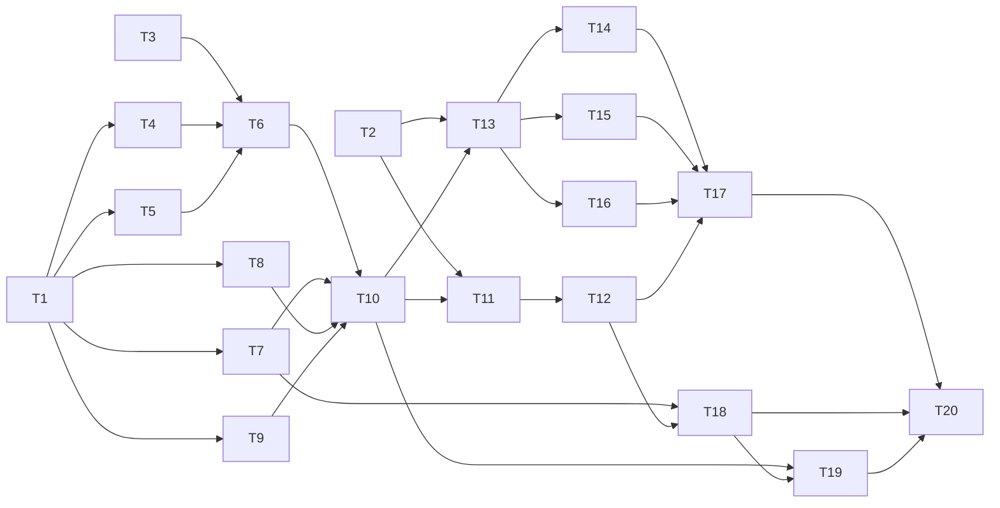

# Tasks: Kuchenmail-Guard

> Status: Freigegeben (2026-10-23) · Basis: requirements.md, design.md (beide freigegeben 2026-10-22)

Fortschritt: 1 / 20 erledigt

Ab Meilenstein 2 gibt es etwas Lauffähiges: ein Kommandozeilen-Check, der sagt, ob eine Mail eine Kuchenmail ist. Ab Meilenstein 4 ist Thunderbird geschützt, danach folgen die Webmailer.

## Meilenstein 1: Fundament und Risiko-Check

- [x] **T1** Projektgerüst
  - Was: Python-Paket `guard/` ohne Fremdabhängigkeiten, Testlauf, `Makefile` mit `test` und `lint` (`python -m compileall`, `web-ext lint` später), `.gitignore`, README mit Kurzbeschreibung.
  - Dateien: `guard/__init__.py`, `tests/test_smoke.py`, `Makefile`, `.gitignore`, `README.md`
  - Fertig wenn: `make test` läuft auf Fedora mit System-Python grün (1 Smoke-Test).
  - _Req: N6_

- [ ] **T2** Spike: Eingriffspunkte prüfen
  - Was: Wegwerf-Erweiterungen, die nur loggen und blockieren, für alle vier Clients. Prüfen: (a) Thunderbird `onBeforeSend` hält das Senden 120 s an und liefert Betreff, Text, Empfänger; (b) Native-Messaging-Manifest-Pfad für Thunderbird auf Fedora; (c) Gmail, Outlook im Web und Roundcube: Senden per Klick und Tastenkürzel abfangbar, Betreff/Text/Empfänger lesbar, Senden nach Freigabe wieder auslösbar. Ergebnisse und funktionierende Selektoren in „Umsetzungsnotizen“.
  - Dateien: `spikes/thunderbird/`, `spikes/webmail/`, `specs/kuchenmail-guard/tasks.md`
  - Fertig wenn: Für jeden der vier Clients steht in den Notizen „abfangbar ja/nein“ plus Selektoren; bei „nein“ ist eine Design-Anpassung vorgeschlagen.
  - Hinweis: Muss auf Linus' Rechner mit seinen Konten laufen (Anleitung liefere ich mit). Braucht Roundcube-Adresse und Outlook-Kontotyp.
  - _Req: R1.2, R2.1, R4.6, R4.7_

## Meilenstein 2: Erkennung (erster lauffähiger Stand)

- [ ] **T3** Test-Korpus
  - Was: Mind. 30 Kuchenmails und 50 normale Mails als `.eml`, Deutsch und Englisch. Normale Mails enthalten bewusst Essens-Wörter ohne Angebot („Kuchen steht in der Küche“, Kantinenplan, Rezept-Weiterleitung, Antwort auf eine fremde Kuchenmail).
  - Dateien: `tests/corpus/cake/*.eml`, `tests/corpus/normal/*.eml`, `tests/corpus/README.md`
  - Fertig wenn: Zählen ergibt ≥ 30 / ≥ 50 Dateien, beide Sprachen vertreten, ≥ 5 Mails mit Zitaten.
  - _Req: N2, N3, R1.4, R1.5_

- [ ] **T4** Regeln laden
  - Was: `default_rules.toml` (Wortlisten DE/EN, Gewichte, Schwelle, `recipient_limit = 3`, `lock_on_detect = false`), `load_rules()` mit `mtime`-Cache und Fallback bei fehlender/kaputter Datei plus Warnung.
  - Dateien: `guard/rules.py`, `guard/default_rules.toml`, `tests/test_rules.py`
  - Fertig wenn: Tests für Laden, Neuladen nach Änderung ohne Neustart, Fallback mit Warnung sind grün.
  - Abhängig von: T1
  - _Req: R4.1, R4.2, R4.3_

- [ ] **T5** Zitate entfernen
  - Was: `strip_quotes(text, html)` für `>`-Zeilen, „Am … schrieb …:“/„On … wrote:“, Weiterleitungs-Kopf, Thunderbird-, Gmail-, Roundcube- und Outlook-HTML-Zitate.
  - Dateien: `guard/quotes.py`, `tests/test_quotes.py`, `tests/fixtures/quotes/`
  - Fertig wenn: Je Client mind. ein HTML- und ein Klartext-Fixture wird korrekt gekürzt.
  - Abhängig von: T1
  - _Req: R1.5_

- [ ] **T6** Klassifikator und CLI
  - Was: `classify(draft, rules) -> Verdict` mit Satz-Score (food + offer, timing als Bonus), Betreff, Empfänger-Bonus; CLI `python -m guard.classify mail.eml` gibt Verdikt und Treffer aus. Gewichte am Korpus kalibrieren.
  - Dateien: `guard/model.py`, `guard/classifier.py`, `guard/classify.py`, `tests/test_classifier.py`, `tests/test_corpus.py`
  - Fertig wenn: Korpustest zeigt ≥ 95 % erkannte Kuchenmails und ≤ 2 Fehlalarme; Test mit 10-kB-Mail < 200 ms; Empfänger > 3 und Verteiler erhöhen den Score.
  - Abhängig von: T3, T4, T5
  - _Req: R1.1, R1.3, R1.4, N2, N3, N4_

## Meilenstein 3: Guard-Host

- [ ] **T7** Versuchs-Log
  - Was: `append`, `pending`, `mark_notified` auf `~/.local/state/kuchenmail-guard/attempts.jsonl`; Ordner 0700, Datei 0600; nur Betreff und Empfänger, kein Mailtext.
  - Dateien: `guard/attempt_log.py`, `tests/test_attempt_log.py`
  - Fertig wenn: Tests prüfen Rechte 0600, Inhalt ohne Mailtext, `pending`/`mark_notified`-Ablauf.
  - Abhängig von: T1
  - _Req: R3.1, R3.3, N1_

- [ ] **T8** Passwort-Freigabe
  - Was: `confirm_send(subject)` mit `zenity --password` und PAM über `ctypes` (Dienst `login`), max. 3 Versuche → `RELEASED`/`CANCELLED`/`FAILED`; Fehler, wenn `zenity` fehlt.
  - Dateien: `guard/auth.py`, `guard/pam.py`, `tests/test_auth.py`
  - Fertig wenn: Unit-Tests mit gemocktem zenity/PAM decken alle drei Ausgänge ab; manueller Check auf Fedora: richtiges Passwort → `RELEASED`, 3× falsch → `FAILED`.
  - Abhängig von: T1
  - _Req: R2.2, R2.3, R2.4, N7_

- [ ] **T9** Bildschirm sperren
  - Was: `lock_screen()` mit `loginctl lock-session`, Fallback D-Bus `org.gnome.ScreenSaver.Lock`, Fehler ins Log.
  - Dateien: `guard/lock.py`, `tests/test_lock.py`
  - Fertig wenn: Tests prüfen Aufruf und Fallback (gemockt); manueller Check sperrt GNOME.
  - Abhängig von: T1
  - _Req: R2.4, R4.5_

- [ ] **T10** Native-Messaging-Host
  - Was: Längenpräfix-Protokoll, Nachrichten `before_send`, `check`, `ping`, Fehlerantworten; Abbildung Verdikt/Outcome → `send`/`cancel`/`discard`; `lock_on_detect` bei `check`; 120-s-Timeout → `cancel`.
  - Dateien: `guard/host.py`, `bin/kuchenmail-guard-host`, `tests/test_host.py`, `tests/test_host_integration.py`
  - Fertig wenn: Integrationstest startet den Host als Subprozess und prüft alle Nachrichten inkl. ungültiger Eingabe; normale Mail → `send` in < 100 ms.
  - Abhängig von: T6, T7, T8, T9
  - _Req: R1.2, R2.1, R2.5, R4.5, N4_

## Meilenstein 4: Thunderbird geschützt

- [ ] **T11** Thunderbird-Erweiterung
  - Was: `onBeforeSend` → `before_send`, `{cancel: true}` bei `cancel`/`discard`, Fenster schließen bei `discard`, fail-closed mit Hinweis bei Port-Fehler; Polling für `check`, wenn `lock_on_detect`.
  - Dateien: `extensions/thunderbird/manifest.json`, `extensions/thunderbird/background.js`
  - Fertig wenn: `web-ext lint` ohne Fehler; manuell auf Fedora: Kuchenmail → Dialog, Abbruch behält Entwurf, Passwort sendet, 3× falsch sperrt; normale Mail geht ohne Dialog raus; Host gestoppt → Senden blockiert mit Hinweis.
  - Abhängig von: T2, T10
  - _Req: R1.2, R2.1, R2.3, R2.4, R2.5, R4.5_

- [ ] **T12** Installer (Teil 1: Host und Thunderbird)
  - Was: `install.sh`/`uninstall.sh` ohne Root: Paket nach `~/.local/share/kuchenmail-guard/`, Starter nach `~/.local/bin/`, Native-Manifeste (nur eigene Erweiterungs-IDs) an die in T2 bestätigten Orte, `rules.toml` nur anlegen, wenn keine existiert, `.xpi` bauen.
  - Dateien: `install.sh`, `uninstall.sh`, `packaging/native-manifest.json.in`
  - Fertig wenn: Auf frischem Fedora-Nutzer installiert ein Befehl alles, Thunderbird-Schutz funktioniert; `uninstall.sh` entfernt alles außer Log und Regeln (mit Hinweis).
  - Abhängig von: T11
  - _Req: N6, R4.4_

## Meilenstein 5: Webmail geschützt

- [ ] **T13** Webmail-Erweiterung: Grundgerüst
  - Was: Background-Script mit Native-Port, Adapter-Schnittstelle (`readDraft`, `onSendAttempt`, `send`, `discard`, `onInput`), gemeinsamer Sende-Ablauf, fail-closed-Hinweis, Optionen-Seite für Roundcube-Adressen (Berechtigung anfordern, Content-Script per `contentScripts.register`).
  - Dateien: `extensions/webmail/manifest.json`, `extensions/webmail/background.js`, `extensions/webmail/flow.js`, `extensions/webmail/options/`
  - Fertig wenn: `web-ext lint` ohne Fehler; Test-Adapter auf einer lokalen HTML-Seite durchläuft `send`/`cancel`/`discard`.
  - Abhängig von: T2, T10
  - _Req: R1.2, R2.1, R2.3, R2.5, R4.5_

- [ ] **T14** Gmail-Adapter
  - Was: Adapter nach T2-Selektoren, Klick und `Strg+Enter`, erneutes Auslösen nach Freigabe, Verwerfen.
  - Dateien: `extensions/webmail/adapters/gmail.js`
  - Fertig wenn: Manuelle Prüfung in Gmail wie bei T11 (alle Ausgänge, normale Mail, Host aus).
  - Abhängig von: T13
  - _Req: R1.2, R2.1, R2.3, R2.4, R2.5_

- [ ] **T15** Outlook-Adapter
  - Was: Adapter nach T2-Selektoren, Deutsch und Englisch, neues Fenster und Inline-Antwort.
  - Dateien: `extensions/webmail/adapters/outlook.js`
  - Fertig wenn: Manuelle Prüfung in Outlook im Web wie bei T11, in beiden Oberflächensprachen.
  - Abhängig von: T13
  - _Req: R4.7, R1.2, R2.1, R2.3, R2.4, R2.5_

- [ ] **T16** Roundcube-Adapter
  - Was: Seitenskript umhüllt `rcmail.command('send')`, Kommunikation per `postMessage`, Text aus Klartext- und HTML-Editor, Verwerfen.
  - Dateien: `extensions/webmail/adapters/roundcube.js`, `extensions/webmail/adapters/roundcube-page.js`
  - Fertig wenn: Manuelle Prüfung auf Linus' Roundcube wie bei T11, in Klartext- und HTML-Editor; Adresse über Optionen-Seite eingetragen.
  - Abhängig von: T13
  - _Req: R4.6, R1.2, R2.1, R2.3, R2.4, R2.5_

- [ ] **T17** Firefox-Erweiterung signieren und installieren
  - Was: `web-ext sign --channel=unlisted`, Installer um Firefox-Manifest und `.xpi` erweitern.
  - Dateien: `Makefile` (Ziel `sign-webmail`), `install.sh`
  - Fertig wenn: Signierte `.xpi` bleibt nach Firefox-Neustart installiert und aktiv.
  - Hinweis: Braucht Linus' AMO-API-Schlüssel; der Schlüssel kommt nicht ins Repo.
  - Abhängig von: T14, T15, T16, T12
  - _Req: N6, R4.4_

## Meilenstein 6: Benachrichtigung und Härtung

- [ ] **T18** Hinweis nach Entsperren
  - Was: `notifier.py` hört auf `ActiveChanged(false)`, meldet `pending()` per `notify-send`, markiert gemeldet; prüft beim Start auch auf offene Versuche; systemd-User-Unit, im Installer aktivieren.
  - Dateien: `guard/notifier.py`, `packaging/kuchenmail-guard-notifier.service`, `tests/test_notifier.py`, `install.sh`
  - Fertig wenn: Test mit simuliertem Signal ruft `notify-send` je Versuch genau einmal; manuell: abgefangener Versuch → sperren → entsperren → Meldung; nach Neuanmeldung läuft der Dienst (`systemctl --user status`).
  - Abhängig von: T7, T12
  - _Req: R3.2, R4.4, N5_

- [ ] **T19** Datenschutz- und Ressourcen-Checks
  - Was: Test, dass kein Modul `socket`, `urllib`, `http` o. Ä. importiert; Messung RAM/CPU von Host und Notifier im Leerlauf.
  - Dateien: `tests/test_no_network.py`, `specs/kuchenmail-guard/tasks.md` (Messwerte in Notizen)
  - Fertig wenn: Test grün; `ss -tunp` zeigt keine Sockets der Prozesse; Notifier < 50 MB RAM und < 1 % CPU.
  - Abhängig von: T10, T18
  - _Req: N1, N5_

- [ ] **T20** End-to-End-Abnahme und Doku
  - Was: `docs/e2e-checklist.md` für alle vier Clients, einmal komplett durchlaufen; README mit Installation, Regeln anpassen, Deinstallation, „was tun, wenn das Tool kaputt ist“.
  - Dateien: `docs/e2e-checklist.md`, `README.md`
  - Fertig wenn: Checkliste vollständig abgehakt auf Fedora, Ergebnis in Notizen.
  - Abhängig von: T17, T18, T19
  - _Req: R1.1–R4.7 (Abnahme), N1–N7_

## Abhängigkeiten

## Abdeckung

| Anforderung | Tasks |
|---|---|
| R1.1 | T6 |
| R1.2 | T2, T10, T11, T13–T16 |
| R1.3 | T6 |
| R1.4 | T3, T6 |
| R1.5 | T3, T5 |
| R2.1 | T2, T10, T11, T13–T16 |
| R2.2 | T8 |
| R2.3 | T8, T11, T13–T16 |
| R2.4 | T8, T9, T11, T14–T16 |
| R2.5 | T10, T11, T13–T16 |
| R3.1 | T7 |
| R3.2 | T18 |
| R3.3 | T7 |
| R4.1, R4.2, R4.3 | T4 |
| R4.4 | T12, T17, T18 |
| R4.5 | T9, T10, T11, T13 |
| R4.6 | T2, T16 |
| R4.7 | T2, T15 |
| N1 | T7, T19 |
| N2, N3 | T3, T6 |
| N4 | T6, T10 |
| N5 | T18, T19 |
| N6 | T1, T12, T17 |
| N7 | T8 |

Jede Anforderung ist mindestens einem Task zugeordnet; die Abhängigkeiten sind zyklenfrei.

## Umsetzungsnotizen

- **T1 (2026-10-23):** Testrunner ist `unittest` aus der Standardbibliothek (`make test`), damit auf Fedora kein `pytest` nachinstalliert werden muss; das Design lässt das ausdrücklich zu. Spätere Tests daher als `unittest.TestCase` schreiben (laufen auch unter pytest). `guard` bricht unter Python < 3.11 mit klarer Meldung ab (wegen `tomllib`). Geprüft mit Python 3.13 im Cloud-Container, noch nicht auf Linus' Fedora.
